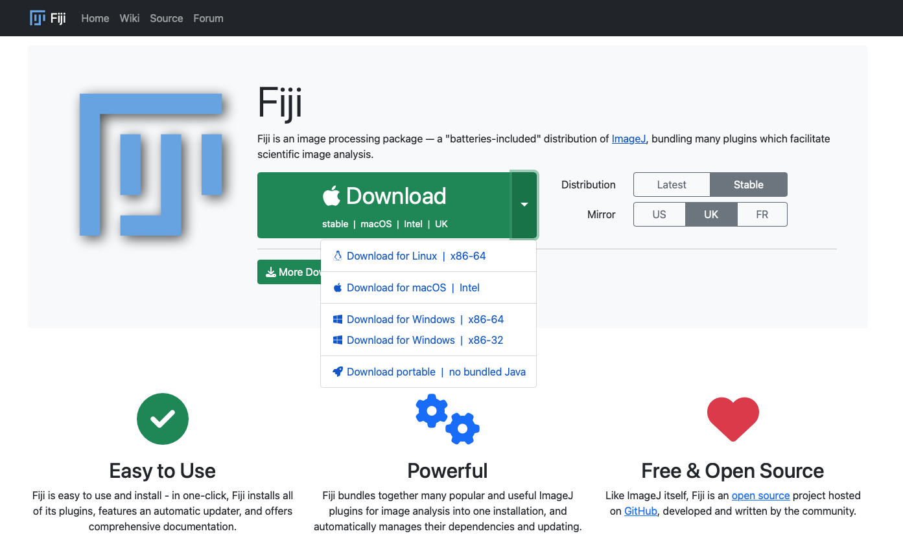
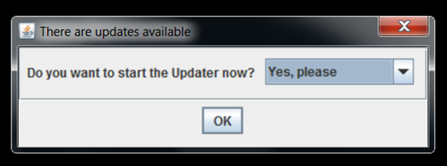
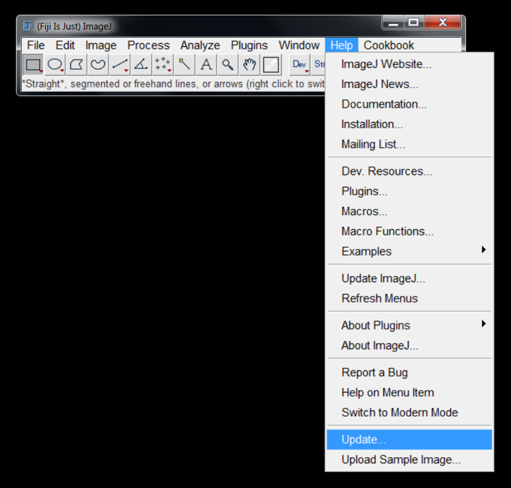
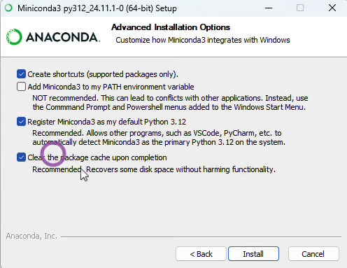
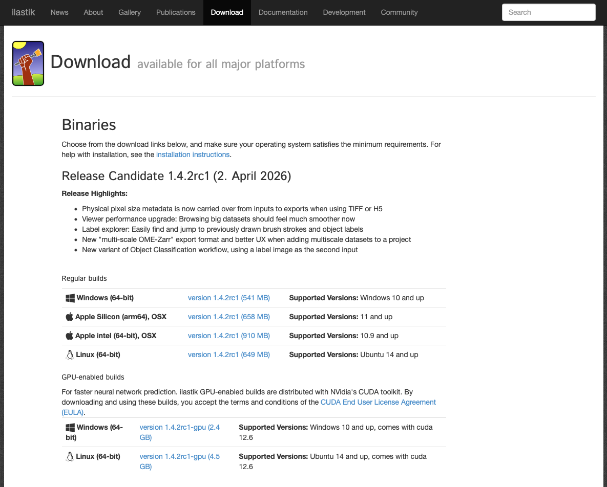
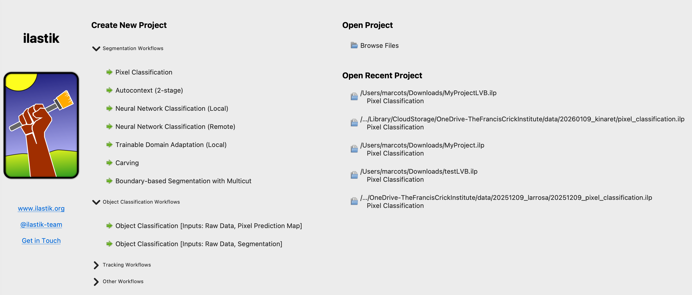
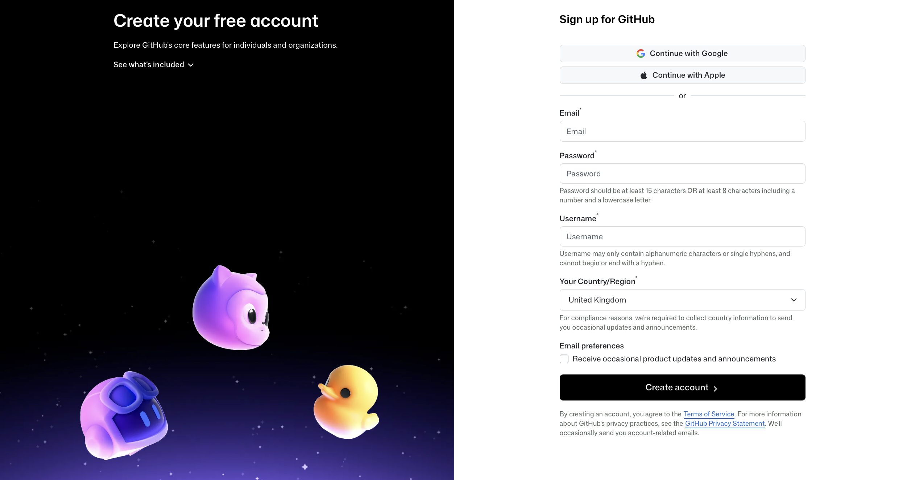

# Preparation For Introduction to Image Analysis Workshop

Please read the following instructions carefully to prepare for the workshop. Completing these steps prior to the workshop is essential to ensure we stay on schedule. If you are having any trouble with the below instructions, please reach out for help:
* For issues with FIJI, contact Sara (sara.salgueirotorres@crick.ac.uk)
* For conda or ilastik issues, contact Stefania (stefania.marcotti@crick.ac.uk)

## Download Demo Data

Download the workshop data by clicking on the link to the ZIP archive at the top of this page.

## Installing FIJI

1. Download FIJI from [here](https://fiji.sc/). Please select the Stable distribution (as opposed to the Latest one).

   

2. To avoid any permissions issues, install FIJI is in your home directory:
   * PC: `C:\users\<your user name>`
   * Mac: `/Users/<your user name>`

   > **WARNING: FIJI *must* be installed in a location where it has write permission - otherwise, it cannot update itself**

3. Start FIJI and allow the updater to run:

   

4. (Optional) If the updater does not run automatically, select `Help > Update`:

   

5. If FIJI produces any error messages, it is most likely because it does not have the necessary permissions to update itself - return to step #2 and double-check the location of the installation.

## Installing conda

1. Install Miniconda by following the installation instructions for your operating system at [this page](https://www.anaconda.com/docs/getting-started/miniconda/install). Choosing the "Graphical installer" option should make it easier, if you're not familiar with using the terminal. 
2. [Windows users only] When prompted, make sure to select "Register Miniconda3 as my default Python 3.13", if not already selected.

   
   
3. Please check that the installation worked properly by opening the Terminal (MacOS) or Anaconda PowerShell Prompt (Windows) and typing `conda list`. If conda has been installed correctly, a list of installed packages appears.

FAQ: "What should I do if I already have `conda` installed on my machine?"

Please make sure that your `conda` installation is up to date. To do so, run the following command:
```
conda --version
```
If this returns a version older than `23.10.0`, please update your `conda` by running:
```
conda update -n base conda
```
## Installing ilastik

1. Install ilastik by following the installation instructions for your operating system at [this page](https://www.ilastik.org/download).



2. ilastik should now be available in your Applications or Programs menu. Double-clicking on the its icon should open a page that looks like this:



## Installing pixi and setting up the StarDist environment

The [counting objects with StarDist](./../Scripts/Jupyter/counting_objects_with_stardist.ipynb) notebook needs its own Python environment, which we manage with [pixi](https://pixi.sh). pixi reads the `pixi.toml` file included in the workshop download and installs exactly the right versions of everything (StarDist, TensorFlow, JupyterLab, etc.) for you.

### 1. Install pixi

* **Windows:** open PowerShell and run:
  ```
  powershell -ExecutionPolicy ByPass -c "irm -useb https://pixi.sh/install.ps1 | iex"
  ```
* **Mac:** open the Terminal and run:
  ```
  curl -fsSL https://pixi.sh/install.sh | sh
  ```

Then **close and reopen** your PowerShell/Terminal window and check that the installation worked by typing:
```
pixi --version
```
If pixi has been installed correctly, a version number appears.

### 2. Set up the environment

1. If you haven't already, download and unzip the workshop data (see [Download Demo Data](#download-demo-data) above).
2. In PowerShell/Terminal, navigate to the unzipped folder - this is the folder that contains the `pixi.toml` file. For example:
   ```
   cd <path to the unzipped folder>
   ```
3. Install the environment:
   ```
   pixi install
   ```
   This downloads several hundred MB, so it may take a few minutes - please do this **before** the workshop, on a good internet connection.

### 3. Check that everything works

Still in the same folder, run:
```
pixi run python -c "from stardist.models import StarDist2D; StarDist2D.from_pretrained('2D_versatile_fluo')"
```
This also downloads the pre-trained StarDist model used in the notebook. Some warnings about GPUs or CUDA may be printed - these are fine and can be ignored. If it finishes without an `Error`, you're all set.

### 4. Launching the notebook (during the workshop)

From the folder containing `pixi.toml`, run:
```
pixi run jupyter lab
```
JupyterLab will open in your web browser. Navigate to `Scripts/Jupyter/` and open `counting_objects_with_stardist.ipynb`.

> **Note:** Always launch JupyterLab with `pixi run` from this folder - do **not** use your conda environment for this notebook.

## Create a GitHub account (if you don't already have one)

1. Go to [https://github.com](https://github.com) and follow the “Sign up” link at the top-right of the window.
2. Follow the instructions to create an account.



3. Verify your email address with GitHub.
4. Configure [multifactor authentication](https://docs.github.com/en/authentication/securing-your-account-with-two-factor-authentication-2fa/about-two-factor-authentication). More information is available on the relevant [GitHub documentation](https://docs.github.com/en/authentication/securing-your-account-with-two-factor-authentication-2fa/configuring-two-factor-authentication).

